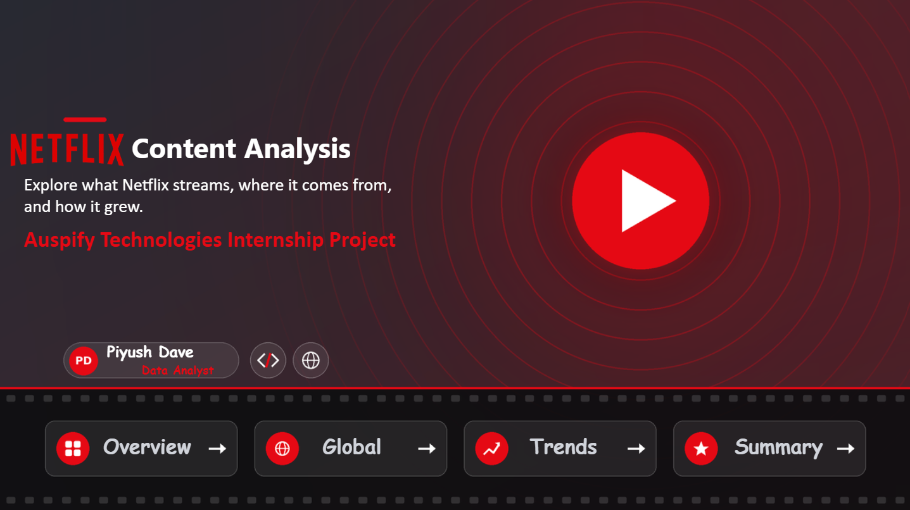
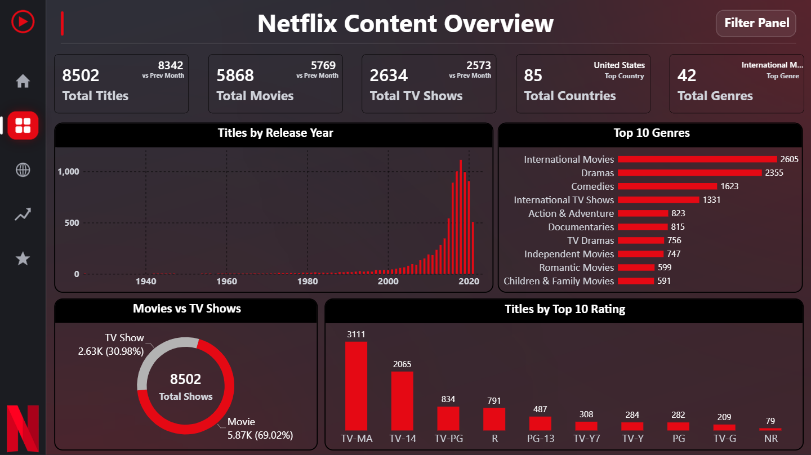
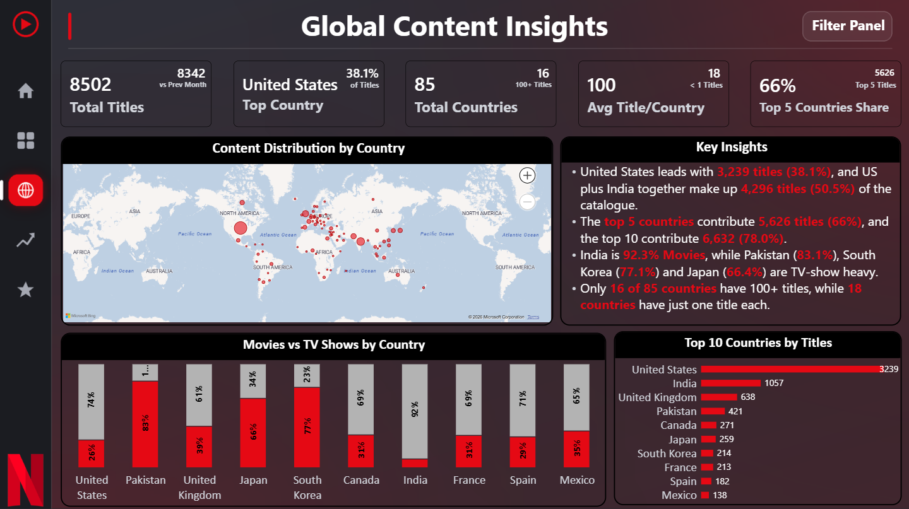
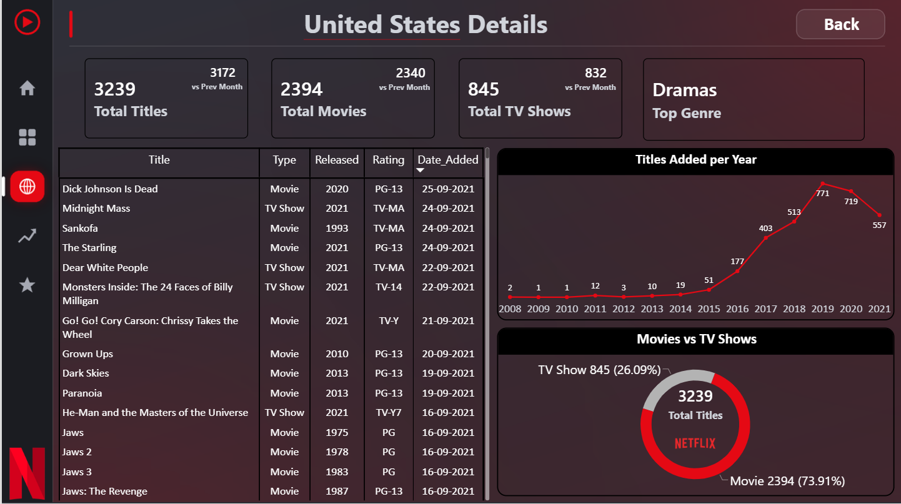
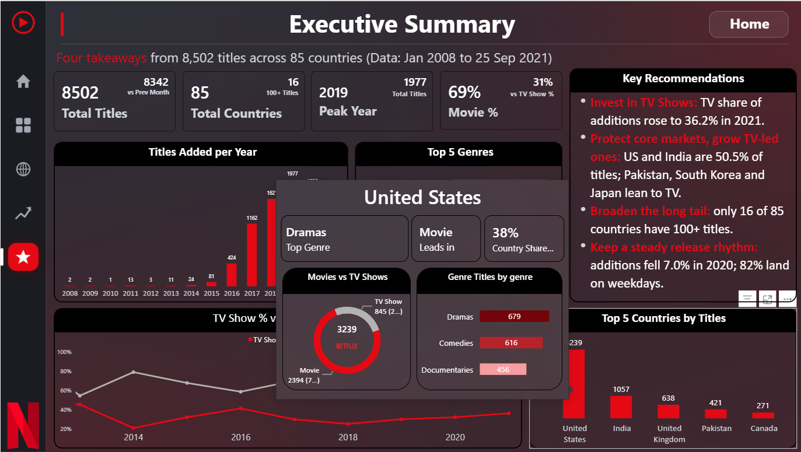
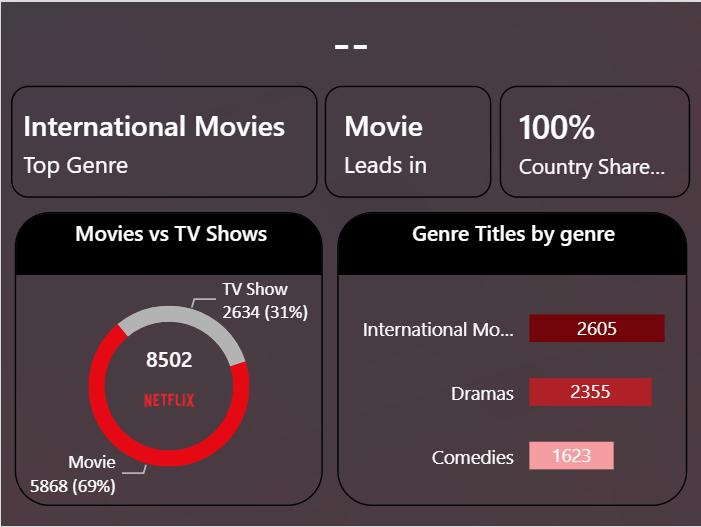
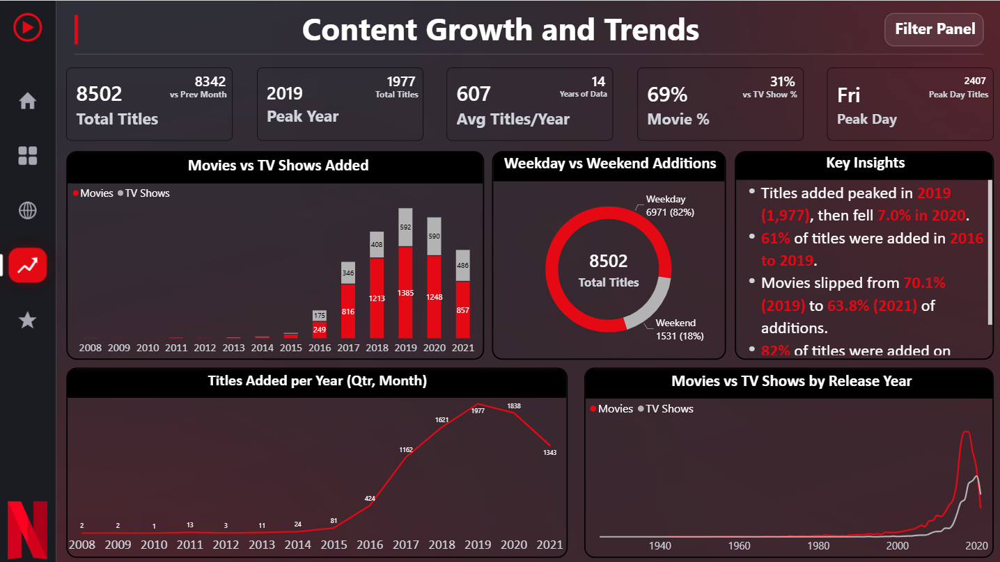
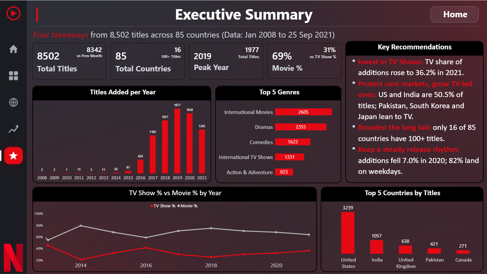
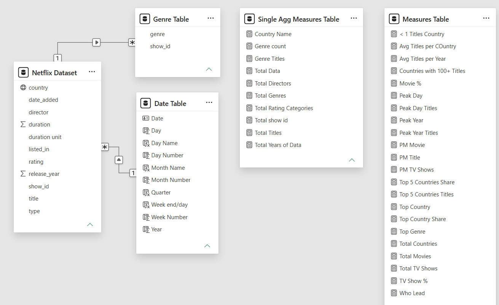
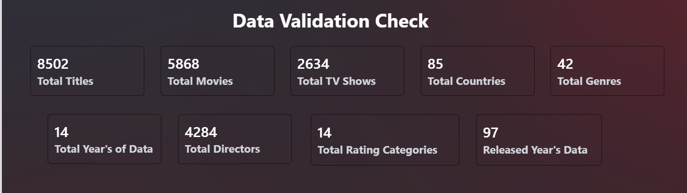

# 📸 Dashboard Screenshots

Screenshots of every page of the **Netflix Content Analysis** Power BI dashboard, built for the **Auspify Technologies Power BI Internship**.

Dataset: **8,502 titles | 85 countries | 42 genres | 2008 to 2021**

---

## 📑 Index

| # | Screenshot | What it shows | Used in |
|---|---|---|---|
| 1 | [Home](#1-home) | Cover page with navigation | Task 6 |
| 2 | [Overview](#2-overview) | Content overview dashboard | Task 2 |
| 3 | [Global](#3-global-content-insights) | Country-wise insights and map | Task 3 |
| 4 | [Country Details](#4-country-details-drill-through) | Drill-through page | Task 3 and Task 6 |
| 5 | [Tooltip Country](#5-tooltip-on-hover) | Report-page tooltip on hover | Task 3 and Task 6 |
| 6 | [Tooltip Page](#6-tooltip-page-design) | Tooltip page design | Task 3 and Task 6 |
| 7 | [Trends](#7-content-growth-and-trends) | Growth and trend analysis | Task 4 |
| 8 | [Executive Summary](#8-executive-summary) | Key takeaways and recommendations | Task 6 |
| 9 | [Data Model](#9-data-model) | Tables and relationships | Task 1 |
| 10 | [Validation Numbers](#10-data-validation) | Data accuracy check | Task 1 |

---

## 1. Home

The landing page. It has the project title, author details and four navigation buttons (Overview, Global, Trends, Summary) on a film-strip.

---

## 2. Overview

Task 2: Netflix Content Overview Dashboard.

- KPI cards: **8,502** Total Titles, **5,868** Movies, **2,634** TV Shows, **85** Countries, **42** Genres
- Movies vs TV Shows donut, Top 10 Genres, Titles by Rating, Titles by Release Year
- Filter Panel (opens and closes with a bookmark)

---

## 3. Global Content Insights

Task 3: Netflix content across countries.

- Map of content by country, Top 10 countries, Movies vs TV Shows mix by country
- Key insight: the **United States has 3,239 titles (38.1%)**, and the **top 5 countries contribute 66.2%** of all titles
- Country slicer in the Filter Panel

---

## 4. Country Details (Drill-through)

A hidden page that opens when you right-click a country and choose **Drill through**. It shows that country's KPIs, titles added per year, a Movies vs TV Shows split and a full title list.

---

## 5. Tooltip on Hover

Hovering over a country in the Top 10 chart shows a mini report: total titles, Movies vs TV Shows split and the top genres for that country.

---

## 6. Tooltip Page Design

The hidden report page (Tooltip page size) that powers the hover tooltip above.

---

## 7. Content Growth and Trends

Task 4: how the catalogue grew over time.

- Titles added per year with **Year, Quarter, Month drill-down**
- Movies vs TV Shows added, weekday vs weekend donut, release year trend
- Key insights: titles added peaked in **2019 (1,977)** and fell **7.0% in 2020**; **82%** of titles are added on weekdays

---

## 8. Executive Summary

Task 6: four recommendations backed by numbers.

1. Invest in TV Shows (TV share of additions rose to **36.2%** in 2021)
2. Protect core markets and grow TV-led ones (US and India are **50.5%** of titles)
3. Broaden the long tail (only **16 of 85** countries have 100+ titles)
4. Keep a steady release rhythm (additions fell **7.0%** in 2020; **82%** land on weekdays)

---

## 9. Data Model

Task 1: data model with the Netflix dataset, Date Table, Genre Table and measure tables, connected through relationships.

---

## 10. Data Validation

Task 1: data accuracy check after cleaning. Totals were verified against the raw file.

---

⬅️ [Back to project](../readme.md)
