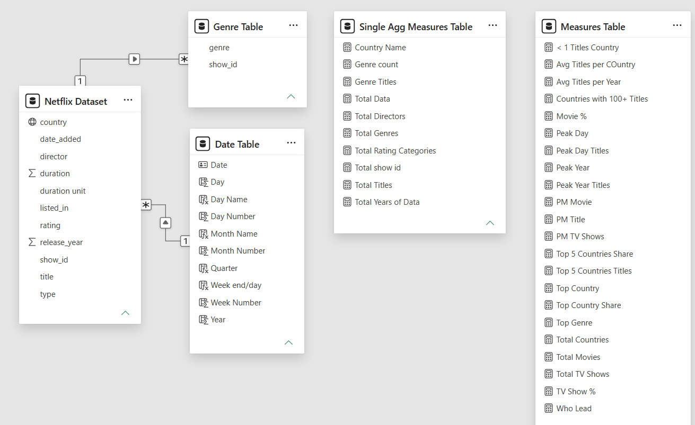
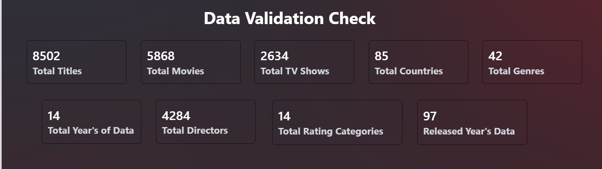

# Task 1: Data Preparation and Power BI Setup

**Goal:** Import, clean and transform the Netflix data so it is ready for reporting and visualization.

## ✅ Workflow

| Step | What was done |
|---|---|
| 1. Import the dataset | Loaded the Netflix dataset (8,790 rows, 10 columns) into Power BI |
| 2. Clean and transform in Power Query | Promoted headers, set correct data types, converted `date_added` to a date, split `duration` into a number and a unit, and cleaned and trimmed the text columns |
| 3. Handle missing values and duplicates | Removed error rows, blank rows and duplicate records (on `show_id`), and removed rows where the country was "Not Given" or blank |
| 4. Create relationships and the data model | Built a star-schema style model with a separate Date Table, a Genre Table and separate measure tables (details below) |
| 5. Validate data accuracy | Checked every total against the raw file (table below) |

## 🧹 Data cleaning summary

| Area | What was done |
|---|---|
| Data types | `show_id`, `type`, `title`, `director`, `country`, `rating`, `listed_in` as text; `release_year` and `duration` as whole numbers; `date_added` as date |
| Duration | Split into **duration** (number) and **duration unit** (Minutes or Seasons) |
| Text | Removed non-printable characters and extra spaces from all text columns |
| Duplicates | Kept one row per `show_id` |
| Missing values | Removed error rows, blank rows and rows with country "Not Given" or blank (287 rows) |
| Genres | `listed_in` holds several genres in one cell, so it was split into rows in a **separate Genre Table** (blank genre values removed) |

## 🗂️ Data model (star schema)

The model follows a **star-schema approach**: one central data table, a dedicated Date Table for time analysis, and measures kept apart from the data.

| Table | Role | Contents |
|---|---|---|
| **Netflix Dataset** | Central data table | country, date_added, director, duration, duration unit, listed_in, rating, release_year, show_id, title, type |
| **Date Table** | Date dimension | Date, Year, Quarter, Month Name, Month Number, Week Number, Day Name, Day Number, Week end/day |
| **Genre Table** | Supporting table for genres | show_id and genre (one row per title and genre) |
| **Single Agg Measures Table** | Measure table (single-value measures) | Total Titles, Total Countries, Total Directors, Total Genres, Total Rating Categories, Total Years of Data |
| **Measures Table** | Measure table (type and time measures) | Total Movies, Total TV Shows, Movie %, TV Show %, PM Title, PM Movie, PM TV Shows |

**Relationships**

| From | To | Type | Key |
|---|---|---|---|
| Date Table | Netflix Dataset | One to many | Date and `date_added` |
| Netflix Dataset | Genre Table | One to many | `show_id` |

**Why this design**
- A **separate Date Table** enables Year, Quarter and Month drill-down and time intelligence such as previous month and previous year.
- A **separate Genre Table** gives the real genre counts (42 genres) without inflating the number of titles.
- **Separate measure tables** keep the DAX organized and easy to find.

## 🔍 Validation

| Check | Result |
|---|---|
| Total Titles | **8,502** |
| Total Movies | **5,868** |
| Total TV Shows | **2,634** |
| Movies + TV Shows | 8,502 (matches Total Titles) |
| Total Countries | **85** |
| Total Genres | **42** |
| Rating categories | **14** |
| Years of data | **14** (2008 to 2021) |
| Genre Table rows | **18,689** |

**Data notes**
- After removing the 287 "Not Given" country rows, 8,503 titles remain in the raw file.
- One record has a line break inside its title, and the CSV import splits it into two broken rows, which are removed as errors. This brings the final count to **8,502**.
- The `director` column also contains "Not Given" values, but it was not needed for the reports.

## 🖼️ Screenshots

**Data model**

**Validation numbers**

⬅️ [Back to tasks](../readme.md)
