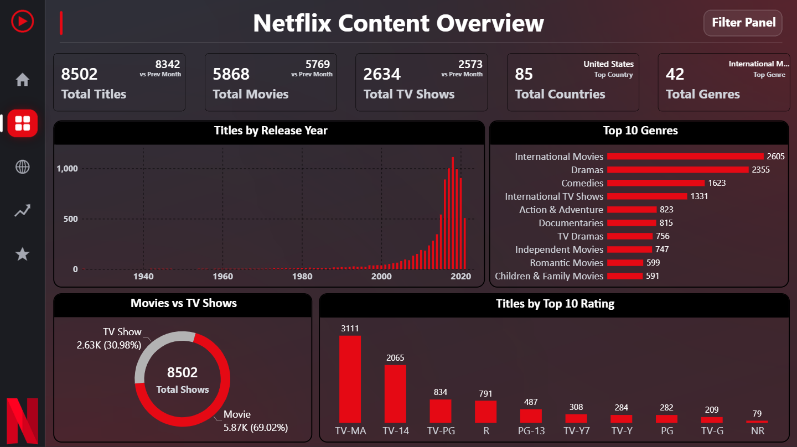

# Task 2: Netflix Content Overview Dashboard (Easy)

**Goal:** Create an interactive dashboard that shows Netflix content distribution and key metrics.

## ✅ Workflow

| Step | What was done |
|---|---|
| 1. Define important KPIs | Total Titles, Movies, TV Shows, Countries, Genres, with previous-month comparison |
| 2. Create cards and charts | KPI cards, Top 10 Genres, Titles by Rating, Titles by Release Year |
| 3. Visualize Movies vs TV Shows | Donut chart with total titles in the centre |
| 4. Add filters and slicers | Filter Panel that opens and closes with a bookmark, and cross-filtering between visuals |
| 5. Optimize dashboard layout | Sidebar navigation, consistent theme, aligned visuals, readable titles and labels |

## 📊 KPI cards

| KPI | Value |
|---|---|
| Total Titles | **8,502** (8,342 previous month) |
| Total Movies | **5,868** |
| Total TV Shows | **2,634** |
| Total Countries | **85** |
| Total Genres | **42** |

## 📈 Visuals

| Visual | Insight |
|---|---|
| Movies vs TV Shows (donut) | Movies are **69.0%** and TV Shows **31.0%** |
| Top 10 Genres | International Movies (**2,605**), Dramas (**2,355**) and Comedies (**1,623**) lead |
| Titles by Rating | TV-MA (**3,111**) and TV-14 (**2,065**) are the biggest groups |
| Titles by Release Year | Releases peak around 2018 and most titles are from 2015 or later |

## 🧮 Key measures

```dax
Total Titles = DISTINCTCOUNT('Netflix Dataset'[show_id])

PM Title =
CALCULATE([Total Titles], DATEADD('Date Table'[Date], -1, MONTH))

Genre Titles = DISTINCTCOUNT('Genre Table'[show_id])
```

Other measures used: Total Movies, Total TV Shows, Movie %, TV Show %, Total Countries, Total Genres.

## 🖼️ Screenshot



⬅️ [Back to tasks](../readme.md)
