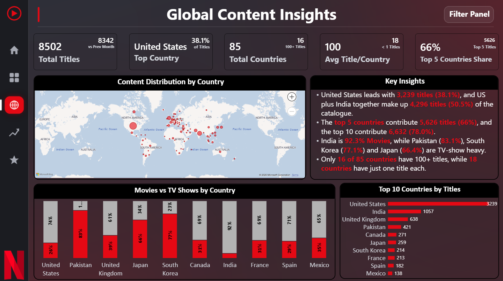
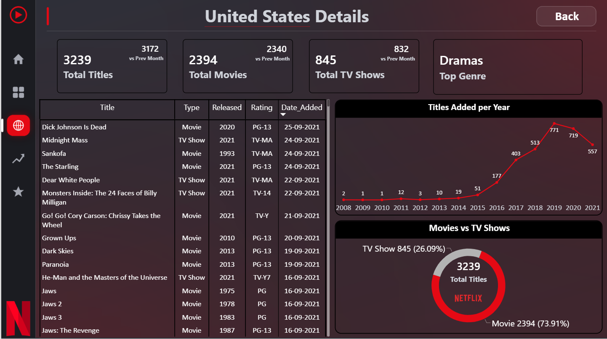
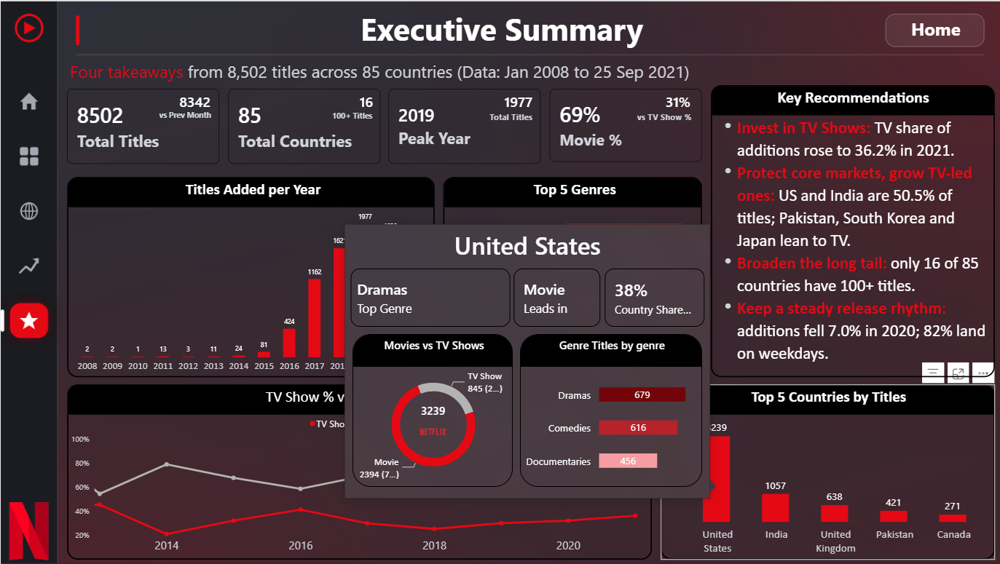
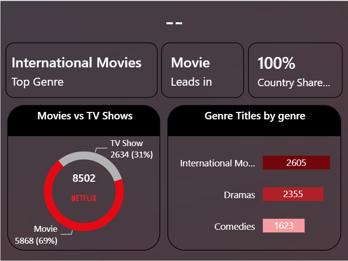

# Task 3: Global Content Insights Dashboard

**Goal:** Analyze Netflix content distribution across countries.

## ✅ Workflow

| Step | What was done |
|---|---|
| 1. Country-level metrics | Top country, top 5 share, countries with 100+ titles, countries with one title, average titles per country |
| 2. Geographic visualizations | Map of titles by country |
| 3. Rank countries by volume | Top 10 countries chart and a Movies vs TV Shows mix by country |
| 4. Interactive filters | Country slicer in the Filter Panel, cross-filtering, **drill-through** to a Country Details page and a custom **report-page tooltip** |
| 5. Present market insights | Key Insights box on the page |

## 🔑 Key insights

- The **United States leads with 3,239 titles (38.1%)**, and the US plus India together make up **4,296 titles (50.5%)**.
- The **top 5 countries** contribute **5,626 titles (66.2%)**, and the top 10 contribute **6,632 (78.0%)**.
- India is **92.3% Movies**, while Pakistan (**83.1%**), South Korea (**77.1%**) and Japan (**66.4%**) are TV-show heavy.
- Only **16 of 85 countries** have 100+ titles, while **18 countries** have just one title each.

## 🏆 Top 10 countries

| # | Country | Titles |
|---|---|---|
| 1 | United States | 3,239 |
| 2 | India | 1,057 |
| 3 | United Kingdom | 638 |
| 4 | Pakistan | 421 |
| 5 | Canada | 271 |
| 6 | Japan | 259 |
| 7 | South Korea | 214 |
| 8 | France | 213 |
| 9 | Spain | 182 |
| 10 | Mexico | 138 |

## 🧮 Key measures

```dax
Top Country =
CONCATENATEX(
    TOPN(1, VALUES('Netflix Dataset'[country]), [Total Titles], DESC),
    'Netflix Dataset'[country]
)

Top Country Share =
DIVIDE(MAXX(VALUES('Netflix Dataset'[country]), [Total Titles]), [Total Titles])

Top 5 Countries Titles =
SUMX(TOPN(5, VALUES('Netflix Dataset'[country]), [Total Titles], DESC), [Total Titles])

Top 5 Countries Share =
DIVIDE([Top 5 Countries Titles],
       CALCULATE([Total Titles], ALL('Netflix Dataset'[country])))

Countries 100+ Titles =
COUNTROWS(FILTER(VALUES('Netflix Dataset'[country]), [Total Titles] >= 100))

One-Title Countries =
COUNTROWS(FILTER(VALUES('Netflix Dataset'[country]), [Total Titles] = 1))

Avg Titles per Country = DIVIDE([Total Titles], [Total Countries])
```

## 🖱️ Interactivity

- **Drill-through:** right-click a country and choose *Drill through* to open **Country Details** (KPIs, titles added per year, Movies vs TV Shows split and the full title list).
- **Tooltip:** hovering over a country in the Top 10 chart shows a mini report with total titles, type split and top genres.

## 🖼️ Screenshots

**Global page**



**Country Details (drill-through)**



**Tooltip on hover**



**Tooltip Page**



⬅️ [Back to tasks](../readme.md)        `      
