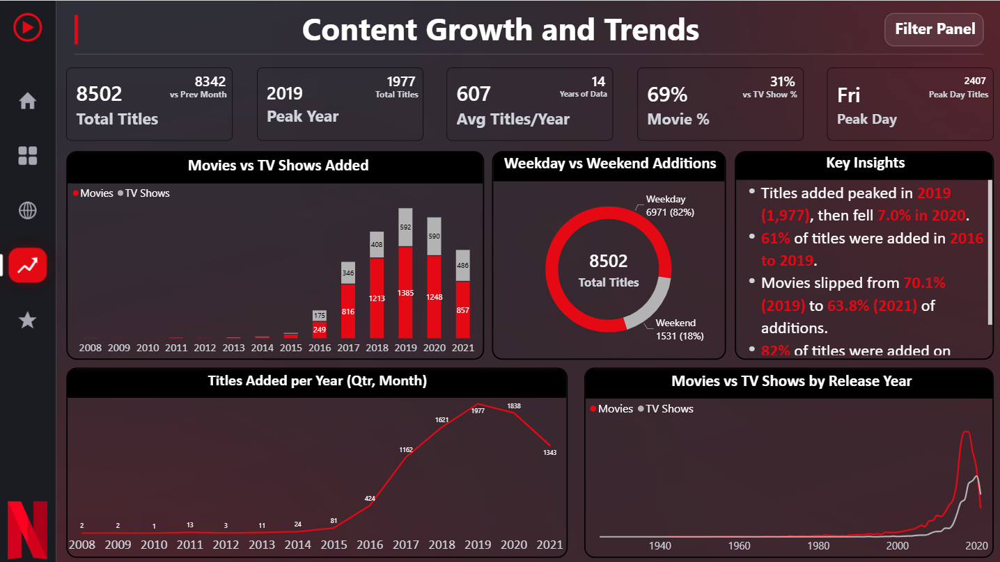

# Task 4: Content Growth and Trend Analysis (Medium)

**Goal:** Develop a dashboard to analyze how Netflix content grew over time.

## ✅ Workflow

| Step | What was done |
|---|---|
| 1. Analyze release year trends | Movies vs TV Shows line chart by release year |
| 2. Create time-series visualizations | Titles added per year with **Year, Quarter, Month drill-down** using the Date Table |
| 3. Track yearly content growth | Titles added per year, plus Movies vs TV Shows added per year |
| 4. Add trend indicators | KPI cards: peak year, average titles per year, previous month, Movie %, peak day |
| 5. Generate growth insights | Key Insights box on the page |

## 🔑 Key insights

- Titles added peaked in **2019 (1,977)**, then fell **7.0% in 2020 (1,838)**.
- **61%** of titles were added in **2016 to 2019**, while 2008 to 2015 added only 137.
- Movies were **70.1%** of additions in 2019 but **63.8%** in 2021, as TV Shows grow.
- **82%** of titles were added on weekdays, with **Friday** leading (**2,407**).
- 2021 covers data only up to 25 September.

## 📅 Titles added per year

| Year | Titles |
|---|---|
| 2016 | 424 |
| 2017 | 1,162 |
| 2018 | 1,621 |
| 2019 | **1,977** |
| 2020 | 1,838 |
| 2021 | 1,343 |

## 🧮 Key measures

```dax
Avg Titles per Year = DIVIDE([Total Titles], [Total Years of Data])

Peak Year Titles =
MAXX(VALUES('Date Table'[Year]), [Total Titles])

Peak Year =
FORMAT(MAXX(TOPN(1, VALUES('Date Table'[Year]), [Total Titles], DESC), 'Date Table'[Year]), "0")

Titles Previous Year =
CALCULATE([Total Titles], SAMEPERIODLASTYEAR('Date Table'[Date]))

Day Type =
IF(WEEKDAY('Date Table'[Date], 2) >= 6, "Weekend", "Weekday")
```

## 🖱️ Interactivity

- The *Titles Added per Year* chart drills down from **Year to Quarter to Month**.
- Every visual cross-filters the others, and KPI cards have custom tooltips.

## 🖼️ Screenshot



⬅️ [Back to tasks](../readme.md)
