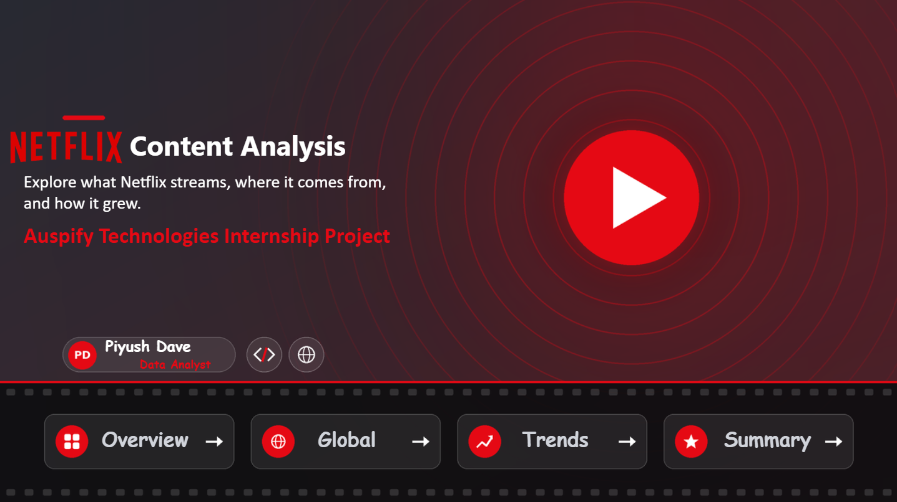
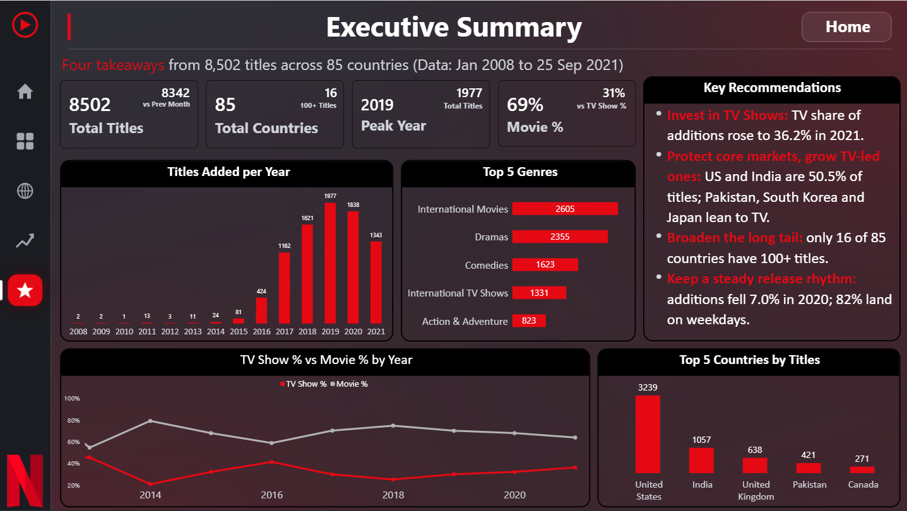

# Task 6: Executive Business Intelligence Dashboard

**Goal:** Create a complete, multi-page Power BI solution that gives strategic insights from Netflix data.

## ✅ Workflow

| Step | What was done |
|---|---|
| 1. Consolidate all business metrics | Measures grouped in measure tables and reused across pages |
| 2. Design a multi-page dashboard | Home, Overview, Global, Trends and Executive Summary, joined by a sidebar and a Home page with navigation buttons |
| 3. Advanced DAX calculations | Top N, share and rank logic, previous-month and previous-year time intelligence, text measures for tooltips |
| 4. Drill-through and drill-down | Year, Quarter, Month drill-down on Trends, and drill-through from Global to Country Details |
| 5. Executive recommendations | Executive Summary page with four recommendations |

## 🧭 Dashboard structure

| Page | Purpose |
|---|---|
| **Home** | Cover page with project title, author and navigation |
| **Overview** | What is in the catalogue (Task 2) |
| **Global** | Where the content comes from (Task 3) |
| **Trends** | How the catalogue grew (Task 4) |
| **Executive Summary** | Key takeaways and recommendations |
| Country Details (hidden) | Drill-through page |
| Tooltip (hidden) | Hover tooltip page |

## 💡 Executive recommendations

| # | Recommendation | Evidence |
|---|---|---|
| 1 | **Invest in TV Shows** | TV share of additions rose from 29.9% (2019) to **36.2%** (2021), and TV Shows lead 2021 releases (302 vs 205) |
| 2 | **Protect core markets, grow TV-led ones** | The US and India are **50.5%** of titles; Pakistan (83.1%), South Korea (77.1%) and Japan (66.4%) lean to TV |
| 3 | **Broaden the long tail** | Only **16 of 85** countries have 100+ titles, and 18 have just one |
| 4 | **Keep a steady release rhythm** | Additions fell **7.0%** in 2020, and **82%** of titles land on weekdays (Friday leads) |

## ✨ Design and features

- Custom dark Netflix-style theme with a sidebar navigation on every page
- Home page with page-navigation buttons
- Filter Panel using bookmarks, drill-down, drill-through and report-page tooltips

## 🖼️ Screenshots

**Home**

**Executive Summary**

⬅️ [Back to tasks](../readme.md)
