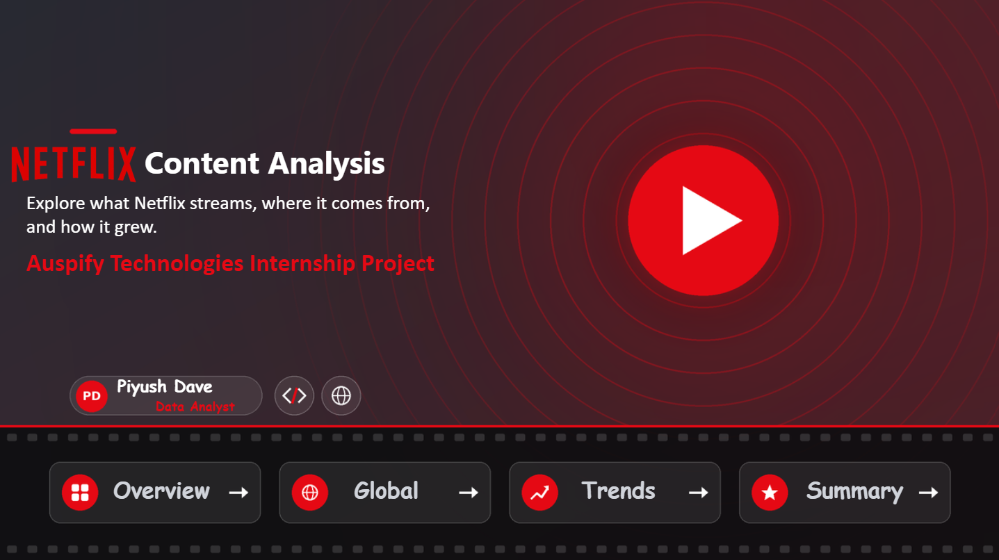
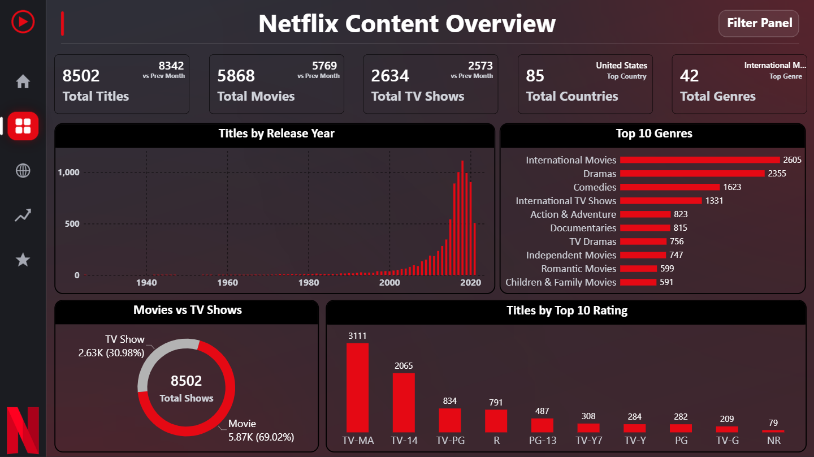
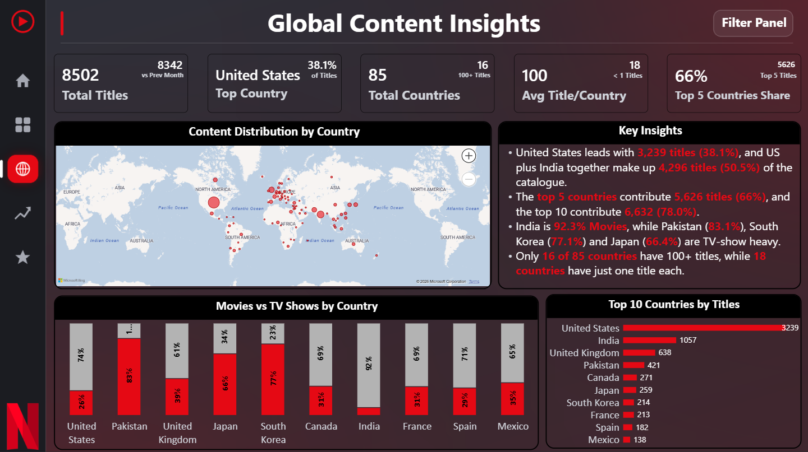
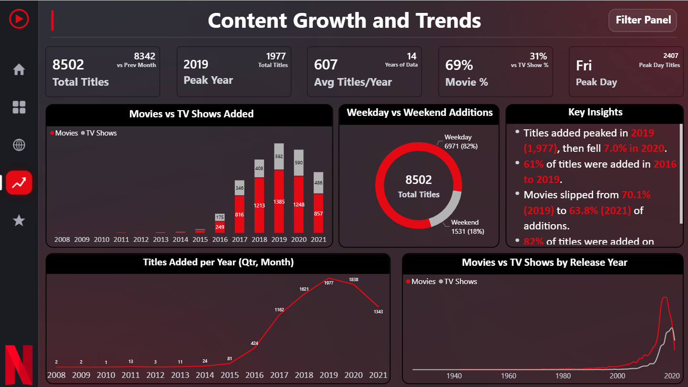
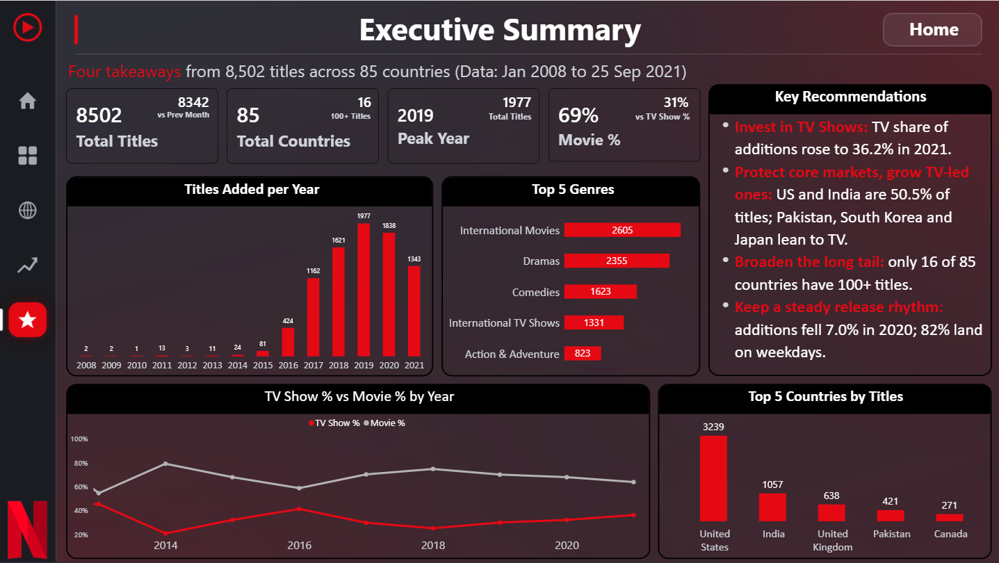
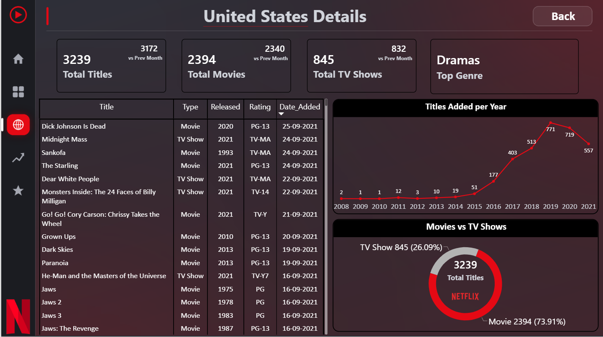
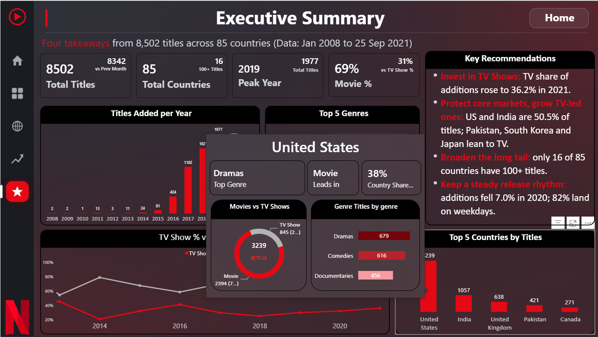
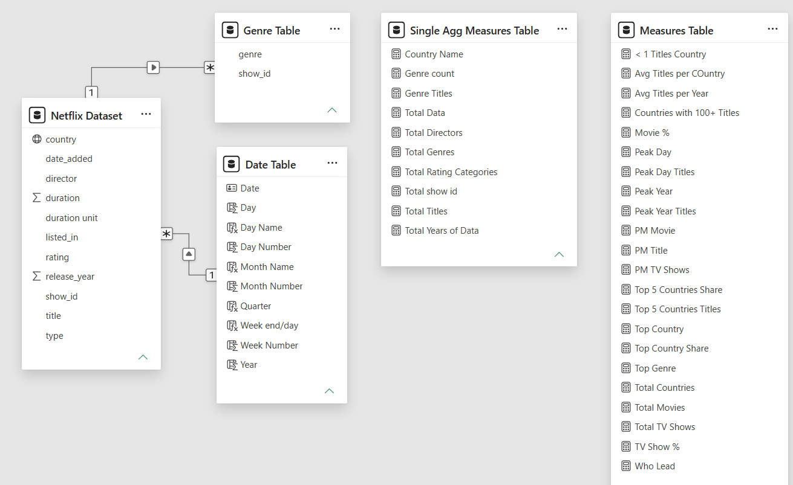

<h1 align="center">🎬 Netflix Content Analysis</h1>
<h3 align="center">Interactive multi-page Power BI dashboard</h3>

<p align="center">
  Analysing <b>8,502 Netflix titles</b> across <b>85 countries</b> and <b>42 genres</b> (2008 to 2021)<br/>
  <i>Auspify Technologies Power BI Internship Project</i>
</p>

<p align="center">
  
  
  
  
</p>

<p align="center">
  <a href="https://www.linkedin.com/in/piyushdave30/"></a>
  <a href="https://public.tableau.com/app/profile/piyushdave/vizzes"></a>
  <a href="mailto:piyushdave3008@gmail.com"></a>
  <a href="https://github.com/PiyushDave30"></a>
</p>



---

## 📑 Table of Contents

- [About the project](#-about-the-project)
- [Dataset at a glance](#-dataset-at-a-glance)
- [Tasks completed](#-tasks-completed)
- [Dashboard pages](#-dashboard-pages)
- [Key insights](#-key-insights)
- [Executive recommendations](#-executive-recommendations)
- [Data model](#%EF%B8%8F-data-model)
- [Features](#-features)
- [Tools and skills](#%EF%B8%8F-tools-and-skills)
- [Repository structure](#-repository-structure)
- [Data and Power BI file](#-data-and-power-bi-file)
- [Author](#-author)

---

## 📌 About the project

This project is a complete, multi-page **Power BI** dashboard built from a Netflix titles dataset. It answers three questions:

1. **What** is in the Netflix catalogue? (Movies vs TV Shows, genres, ratings, release years)
2. **Where** does the content come from? (countries and regional mix)
3. **How** did the catalogue grow over time? (yearly, monthly and weekday patterns)

It ends with an **Executive Summary** of four recommendations backed by numbers. The work was done as part of the **Auspify Technologies Power BI Internship**, where any 4 of 6 tasks had to be completed.

---

## 🔢 Dataset at a glance

| Metric | Value |
|---|---|
| Titles | **8,502** |
| Movies / TV Shows | **5,868 / 2,634** (69.0% / 31.0%) |
| Countries | **85** |
| Genres | **42** |
| Years of data (date added) | **14** (2008 to 2021) |
| Rating categories | **14** |

---

## ✅ Tasks completed

| Task | Title | Level | Status | Details |
|---|---|---|---|---|
| 1 | Data Preparation and Power BI Setup | Easy | ✅ Completed | [Task-1](Tasks/Task-1/readme.md) |
| 2 | Netflix Content Overview Dashboard | Easy | ✅ Completed | [Task-2](Tasks/Task-2/readme.md) |
| 3 | Global Content Insights Dashboard | Medium | ✅ Completed | [Task-3](Tasks/Task-3/readme.md) |
| 4 | Content Growth and Trend Analysis | Medium | ✅ Completed | [Task-4](Tasks/Task-4/readme.md) |
| 5 | Audience and Content Category Intelligence | Advanced | ⏭️ Skipped | n/a |
| 6 | Executive Business Intelligence Dashboard | Advanced | ✅ Completed (bonus) | [Task-6](Tasks/Task-6/readme.md) |

> Tasks 1, 2, 3 and 4 meet the required 4 of 6. Task 6 was completed as a bonus, and Task 5 was skipped. See the [Task Overview](Tasks/readme.md).

---

## 📊 Dashboard pages

The dashboard has 5 visible pages with a sidebar for navigation, plus 2 hidden pages for drill-through and tooltips.

### 🏠 Home
A cover page with the project title, author details and four navigation buttons.


### 📈 Overview *(Task 2)*
KPI cards, Movies vs TV Shows donut, Top 10 Genres, Titles by Rating and Titles by Release Year, with a Filter Panel.



### 🌍 Global Content Insights *(Task 3)*
Map of content by country, Top 10 countries, Movies vs TV Shows mix by country, and key insights.



### 📅 Content Growth and Trends *(Task 4)*
Titles added per year with Year, Quarter, Month drill-down, Movies vs TV Shows added, weekday pattern and release-year trend.



### ⭐ Executive Summary *(Task 6)*
Four recommendations with supporting charts.



### 🔎 Drill-through and Tooltip

| Country Details (drill-through) | Tooltip on hover |
|---|---|
|  |  |

📸 All screenshots: [Screenshots folder](Screenshots/readme.md)

---

## 💡 Key insights

**Content mix and categories**
- Movies make up **69.0%** of the catalogue and TV Shows **31.0%**.
- The top genres are **International Movies (2,605)**, **Dramas (2,355)** and **Comedies (1,623)**.
- **TV-MA (3,111)** and **TV-14 (2,065)** are the largest rating groups.

**Where the content comes from**
- The **United States leads with 3,239 titles (38.1%)**, and the US plus India make up **50.5%**.
- The **top 5 countries** contribute **66.2%** of titles, and the top 10 contribute **78.0%**.
- India is **92.3% Movies**, while Pakistan (**83.1%**), South Korea (**77.1%**) and Japan (**66.4%**) are TV-show heavy.
- Only **16 of 85 countries** have 100+ titles, while **18** have just one.

**How the catalogue grew**
- Titles added peaked in **2019 (1,977)** and fell **7.0% in 2020**.
- **61%** of titles were added between **2016 and 2019**.
- Movies were **70.1%** of additions in 2019 but **63.8%** in 2021, as TV Shows grow.
- **82%** of titles are added on weekdays, with **Friday** leading (**2,407**).

---

## 🎯 Executive recommendations

| # | Recommendation | Evidence |
|---|---|---|
| 1 | **Invest in TV Shows** | TV share of additions rose to **36.2%** in 2021, and TV Shows lead 2021 releases (302 vs 205) |
| 2 | **Protect core markets, grow TV-led ones** | The US and India are **50.5%** of titles; Pakistan, South Korea and Japan lean to TV |
| 3 | **Broaden the long tail** | Only **16 of 85** countries have 100+ titles |
| 4 | **Keep a steady release rhythm** | Additions fell **7.0%** in 2020, and **82%** of titles land on weekdays |

---

## 🗂️ Data model

A **star-schema approach** with a central data table, a dedicated Date Table, a Genre Table and separate measure tables.



| Table | Role |
|---|---|
| **Netflix Dataset** | Central data table |
| **Date Table** | Date dimension (Year, Quarter, Month, Day) |
| **Genre Table** | One row per title and genre (gives the real 42 genres) |
| **Single Agg Measures Table** and **Measures Table** | Organized DAX measures |

More details: [Task-1](Tasks/Task-1/readme.md)

---

## ✨ Features

- Multi-page dashboard with **sidebar navigation** and a Home page with navigation buttons
- Custom **dark Netflix-style theme** and page backgrounds
- **Filter Panel** that opens and closes with bookmarks
- **Drill-down** (Year, Quarter, Month) and **drill-through** (country to Country Details)
- **Report-page tooltip** and measure-based tooltips on KPI cards
- Cross-filtering between visuals, and advanced DAX (Top N, share, ranking, time intelligence)

---

## 🛠️ Tools and skills

| Tools | Skills |
|---|---|
| Power BI Desktop | Data cleaning with Power Query |
| Power Query | Data modelling (Date and Genre tables) |
| DAX | DAX measures and time intelligence |
| | Dashboard design and navigation |
| | Data storytelling and insights |

---

## 📂 Repository structure

```
Netflix-PowerBI-Dashboard/
│
├─ readme.md                  Main project README (this file)
│
├─ Project Files/
│   └─ readme.md              Dataset, data model, measures, how to request the files
│
├─ Screenshots/
│   ├─ readme.md              All 10 dashboard screenshots
│   └─ *.png
│
└─ Task/
    ├─ readme.md              Task overview
    ├─ Task-1/                Data preparation and setup
    ├─ Task-2/                Content overview dashboard
    ├─ Task-3/                Global content insights
    ├─ Task-4/                Content growth and trends
    └─ Task-6/                Executive BI dashboard
```

---

## 🔒 Data and Power BI file

The raw dataset and the Power BI file (`.pbix`) are **not published** in this repository. If you would like the data, the Power BI file or project-related details, please contact me by **email** or **LinkedIn**. More information is in the [Project Files](Project%20Files/readme.md) folder.

---

## 👤 Author

**Piyush Dave** | Data Analyst

<p>
  <a href="https://www.linkedin.com/in/piyushdave30/"></a>
  <a href="https://public.tableau.com/app/profile/piyushdave/vizzes"></a>
  <a href="mailto:piyushdave3008@gmail.com"></a>
  <a href="https://github.com/PiyushDave30"></a>
</p>

---

🙏 Thanks to **Auspify Technologies** for the internship and the Power BI task list.

`#Auspify` `#AuspifyTechnologies` `#AuspifyInternship` `#AuspifyProjects`

