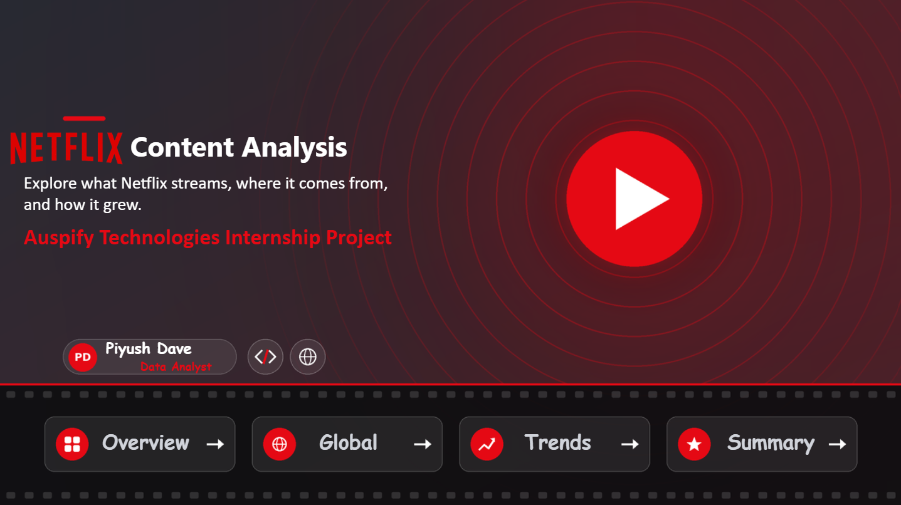
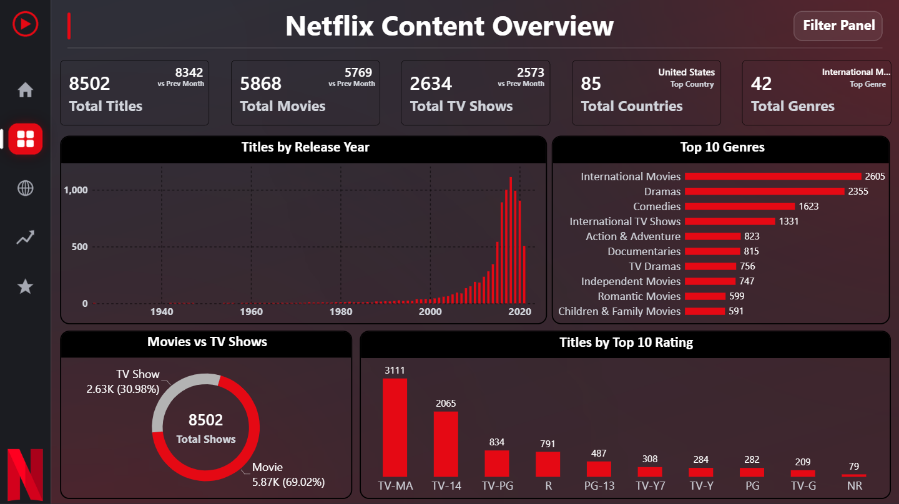
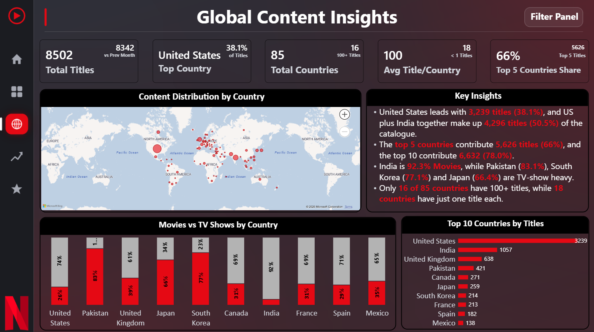
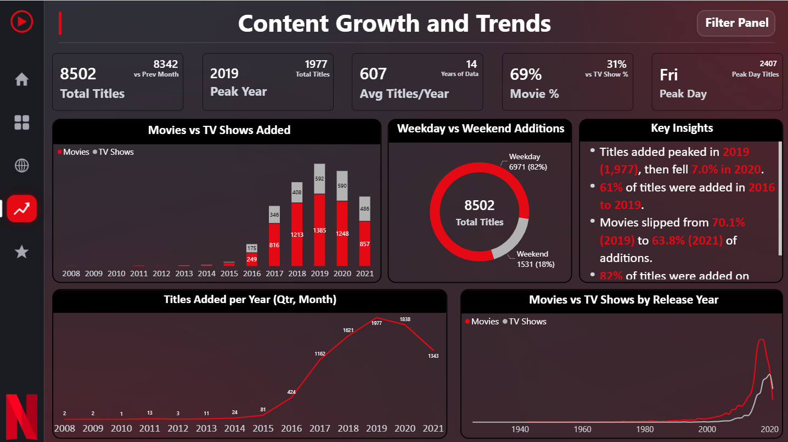
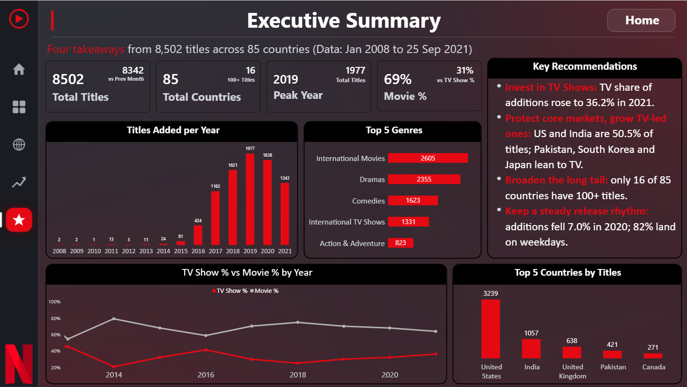

<h1 align="center">🚀 Auspify Technologies Internship Project</h1>
<h3 align="center">Power BI Internship Program | Learn • Build • Grow</h3>

<p align="center">
  Projects and task submissions by <b>Piyush Dave</b>, Data Analyst
</p>

<p align="center">
  
  
  
  
</p>

<p align="center">
  <a href="https://www.linkedin.com/in/piyushdave30/"></a>
  <a href="https://public.tableau.com/app/profile/piyushdave/vizzes"></a>
  <a href="mailto:piyushdave3008@gmail.com"></a>
  <a href="https://github.com/PiyushDave30"></a>
</p>



---

## 📑 Table of Contents

- [About the internship](#-about-the-internship)
- [Projects in this repository](#-projects-in-this-repository)
- [Task progress](#-task-progress)
- [Project highlights](#-project-highlights)
- [Skills demonstrated](#-skills-demonstrated)
- [Repository structure](#-repository-structure)
- [Data and Power BI file](#-data-and-power-bi-file)
- [Author](#-author)

---

## 🏢 About the internship

**Auspify Technologies** is a technology and training platform that helps students build industry-ready skills through internships and project-based learning.

This repository contains my work for the **Power BI Internship Program** (a 4-week practical learning program). The program had 6 Power BI tasks, and **any 4 of the 6 tasks** had to be completed. All tasks use a **Netflix dataset** and cover data preparation, dashboards, trend analysis and business intelligence.

---

## 📂 Projects in this repository

| Project | Description | Links |
|---|---|---|
| 🎬 **[Netflix-PowerBI-Dashboard](Netflix-PowerBI-Dashboard/readme.md)** | Interactive multi-page Power BI dashboard analysing **8,502 Netflix titles** across **85 countries** and **42 genres** (2008 to 2021) | [Project README](Netflix-PowerBI-Dashboard/readme.md) · [Screenshots](Netflix-PowerBI-Dashboard/Screenshots/readme.md) · [Task details](Netflix-PowerBI-Dashboard/Task/readme.md) · [Project files](Netflix-PowerBI-Dashboard/Project%20Files/readme.md) |

---

## ✅ Task progress

| Task | Title | Level | Status |
|---|---|---|---|
| 1 | Data Preparation and Power BI Setup | Easy | ✅ Completed |
| 2 | Netflix Content Overview Dashboard | Easy | ✅ Completed |
| 3 | Global Content Insights Dashboard | Medium | ✅ Completed |
| 4 | Content Growth and Trend Analysis | Medium | ✅ Completed |
| 5 | Audience and Content Category Intelligence | Advanced | ⏭️ Skipped |
| 6 | Executive Business Intelligence Dashboard | Advanced | ✅ Completed (bonus) |

> Tasks 1, 2, 3 and 4 meet the required 4 of 6. Task 6 was completed as a bonus. Details for each task are in the [Task folder](Netflix-PowerBI-Dashboard/Task/readme.md).

---

## 🌟 Project highlights

| | |
|---|---|
| 📊 **Pages** | Home, Overview, Global, Trends and Executive Summary, plus hidden Country Details and Tooltip pages |
| 🌍 **Top market** | The **United States** has **38.1%** of titles, and the US plus India make up **50.5%** |
| 📈 **Growth** | Titles added peaked in **2019 (1,977)**, and **82%** of titles are added on weekdays |
| 📺 **Trend** | TV Shows reached **36.2%** of additions in 2021, up from 29.9% in 2019 |
| 🧭 **Interactivity** | Sidebar navigation, Filter Panel bookmarks, drill-down, drill-through and report-page tooltips |

| Overview | Global |
|---|---|
|  |  |

| Trends | Executive Summary |
|---|---|
|  |  |

---

## 🧠 Skills demonstrated

- Data cleaning and transformation with **Power Query**
- Data modelling (central data table, Date Table, Genre Table, measure tables)
- **DAX** measures, time intelligence and ranking logic
- Dashboard design, navigation and interactivity
- Data storytelling and executive recommendations

---

## 🗂️ Repository structure

```
Auspify-Technologies-Internship-Project/
│
├─ readme.md                        This file
│
└─ Netflix-PowerBI-Dashboard/
    ├─ readme.md                    Project README
    ├─ Project Files/               Dataset, data model, how to request the files
    ├─ Screenshots/                 All 10 dashboard screenshots
    └─ Task/                        Task-1, Task-2, Task-3, Task-4, Task-6
```

---

## 🔒 Data and Power BI file

The raw dataset and the Power BI file (`.pbix`) are **not published** in this repository. If you would like the data, the Power BI file or project-related details, please contact me by **email** or **LinkedIn**. See the [Project Files](Netflix-PowerBI-Dashboard/Project%20Files/readme.md) page for more information.

---

## 👤 Author

**Piyush Dave** | Data Analyst

📧 [piyushdave3008@gmail.com](mailto:piyushdave3008@gmail.com) · 💼 [LinkedIn](https://www.linkedin.com/in/piyushdave30/) · 💻 [GitHub](https://github.com/PiyushDave30) · 📊 [Tableau Public](https://public.tableau.com/app/profile/piyushdave/vizzes)

---

🙏 Thanks to **Auspify Technologies** for the internship opportunity.

`#Auspify` `#AuspifyTechnologies` `#AuspifyInternship` `#AuspifyProjects`
